# Office Sentry

**Branded Microsoft 365 security and licensing reports for every client, without gathering anything by hand.**
Office Sentry reads each client's Microsoft 365 every night, keeps the history, and turns it into the reports an MSP
actually sends: a monthly review, evidence for Cyber Essentials and insurance forms, 53 detail reports, a page for
every person, mailbox, group and site, a view across all clients, and what changed since last month. It never changes
anything in a client's tenant.

- **Free and open source** (AGPL-3.0), every feature included: no editions, no per-client pricing, no telemetry.
- **Self-hosted** on a small server of your own: Linux with Docker (2 CPUs and 4 GB of memory), or Windows. Your
  clients' data stays with you.
- **One read-only app per client**, approved by the client's admin from a link you send, or by your technician
  through GDAP. No agents, and no Partner Center needed.

[](https://github.com/JackD99/OfficeSentry/actions/workflows/v2.yml)
[](https://github.com/JackD99/OfficeSentry/releases/latest)
[](https://github.com/JackD99/OfficeSentry/pkgs/container/officesentry)
[](LICENSE)

[Website](https://officesentry.co.uk) · [Live demo](https://demo.officesentry.co.uk) (fictional clients, no sign-up) · [Example reports (PDF)](examples/) · [Quick start](#quick-start) ·
[How it compares](website/pages/compare/reporting-tools.md) · [What it reads](v2/docs/what-office-sentry-reads.md) · [Security model](#security-model) · [Getting help](SUPPORT.md) ·
[Technical reference](v2/README.md)

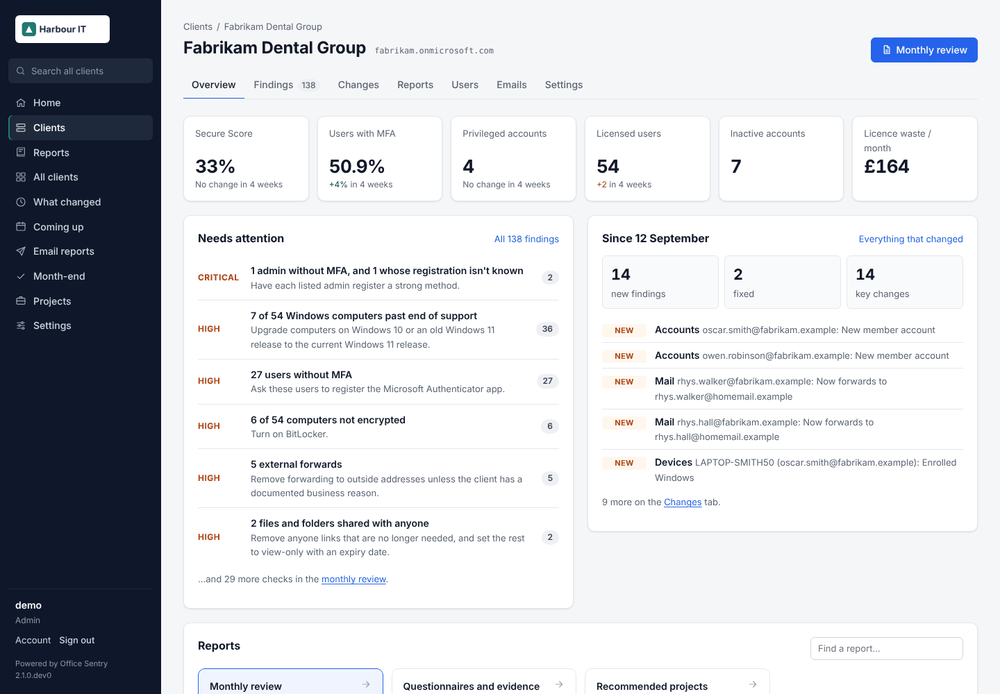

<sub>Every screenshot and example report here comes from fictional demo data: made-up companies, people and
`.example` domains.</sub>

## Why

An MSP's technical lead spends days a month on the same chores for every client: exporting MFA status, checking
who forwards mail outside, counting licences nobody uses, filling in insurance questionnaires, and pasting it all
into a report the client will understand. Microsoft keeps the answers in a dozen admin centres, in its own words,
with no history.

Office Sentry does the gathering every night for every client and keeps the results. The report is ready when you
need it: branded with your logo, in plain English, with what changed since last time and what to fix first. You
review it and send it, or let it email itself.

### Instead of a paid tool?

For reporting, it does the job paid tools are bought for: monthly client reviews, evidence for Cyber Essentials,
ISO 27001, CIS and insurers, 53 detail reports and 71 checks across every client, with history. What it doesn't do,
plainly:

- **It reports; it doesn't manage.** It never creates users, changes settings or fixes findings, so it sits beside
  CIPP or your RMM rather than replacing them.
- **Nightly, not real time.** It collects every night, or when you ask, and alerts by email, Teams, Slack or a
  webhook. There's no PSA integration.
- **You run it.** There's no hosted version, and support is the docs and GitHub Discussions.

[How it compares](website/pages/compare/reporting-tools.md) with Microsoft's admin centres, PowerShell, CIPP and
AdminDroid, and [Office Sentry vs AdminDroid](website/pages/compare/admindroid.md) and
[Office Sentry and CIPP](website/pages/compare/cipp.md) side by side.

## What you get

### Client reports and PDFs

The **Monthly Security & Licensing Review** leads with the answer on two summary pages. *At a glance* has what was
checked, what changed, the key figures with their 4-week change and the findings by severity. *This month* has the
findings found and fixed each month, what was done and what to do next. The detail follows as an appendix: what
changed, the Secure Score trend, each failing check with the accounts affected, licence waste in money and the checks
that passed. It is a web page, a branded PDF and a spreadsheet, and reads well on a phone. The **Summary PDF** is the
two summary pages on their own ([open it](examples/monthly-review-summary.pdf)), and report plans and email schedules
can send just that.

<table>
  <tr>
    <td width="50%">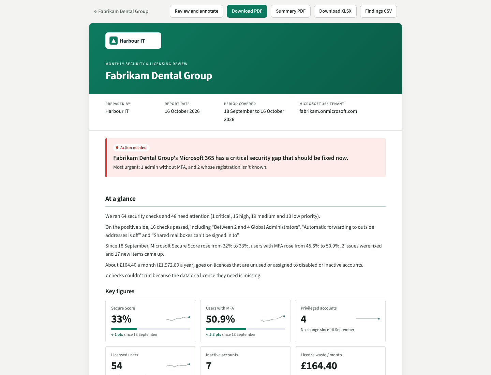</td>
    <td width="25%">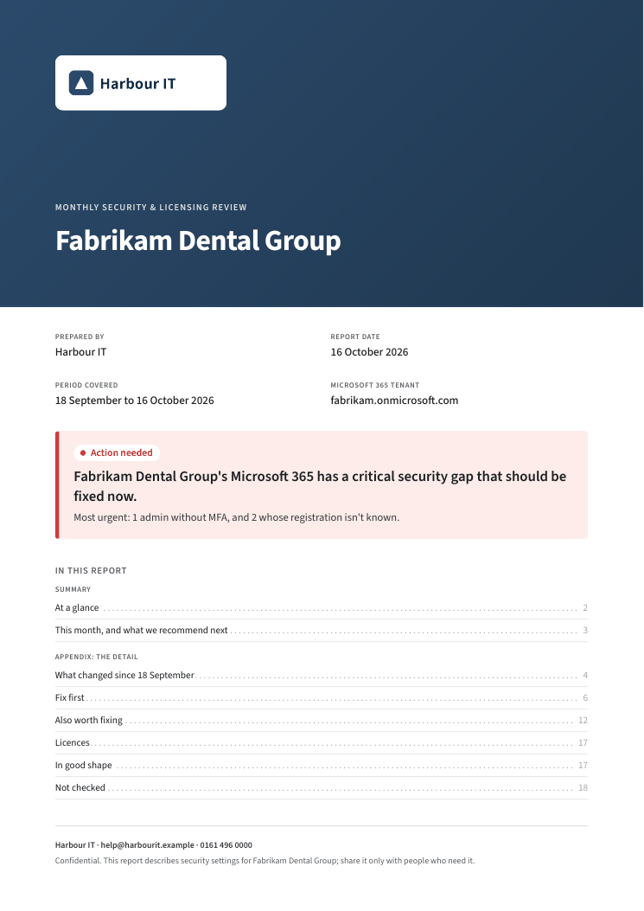</td>
    <td width="25%">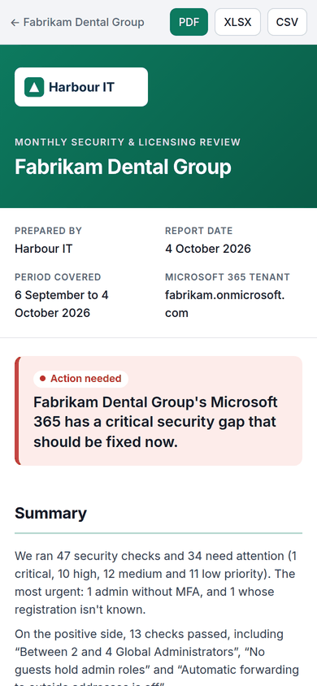</td>
  </tr>
  <tr>
    <td>The review in the portal</td>
    <td>The PDF, with your branding (<a href="examples/monthly-security-licensing-review.pdf">open it</a>)</td>
    <td>On a phone</td>
  </tr>
</table>

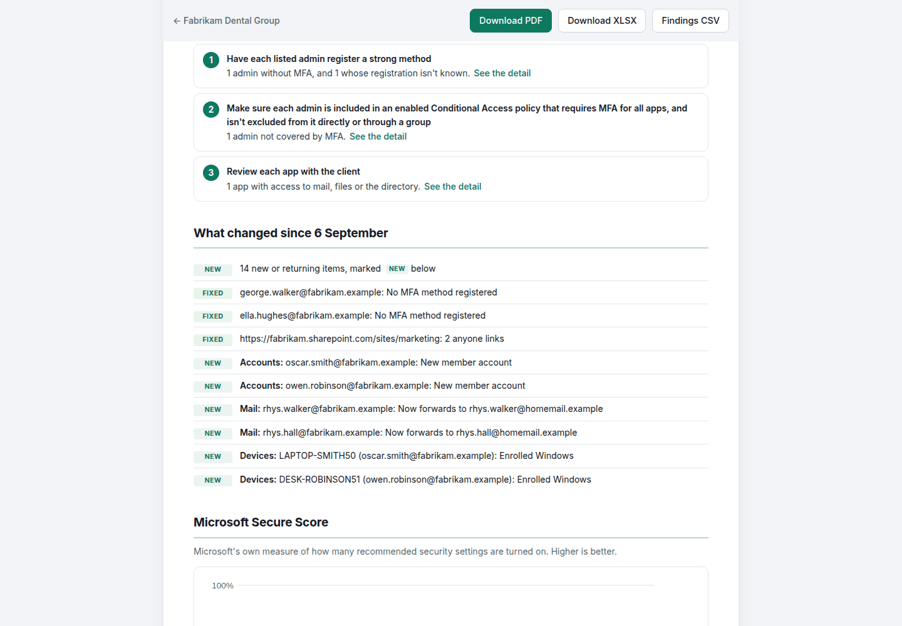

Before a month's reports go out, **Month-end** lists every client to review. On each one you write the commentary,
pick what you recommend next, add notes to findings and leave out anything that client shouldn't get this month (a
check, a key figure, a whole part of the report), with a preview of the client's copy beside you. Then approve
one client or many: each is frozen as it is and emailed or published to the client's portal.
Anything you change after approving waits for a new version, so the client's portal always matches what they were sent.

**Custom reports** let an account manager build their own client report without code: drag in blocks (a
verdict, key figures, failing checks, what changed, licences, a table from any detail report, your own text),
set each one up, see it on a real client as you go, and send it with a report plan or a client's email
schedule (*Send on a schedule* on the client's Custom reports page starts one with it ticked). Start from an
executive summary, a full review, a licensing review or a **Quarterly review**: three months of Secure Score
and findings, what was fixed, the projects on the table and where each stands, licence spend and what's coming
up in the next 90 days ([example PDF](examples/quarterly-review.pdf)).

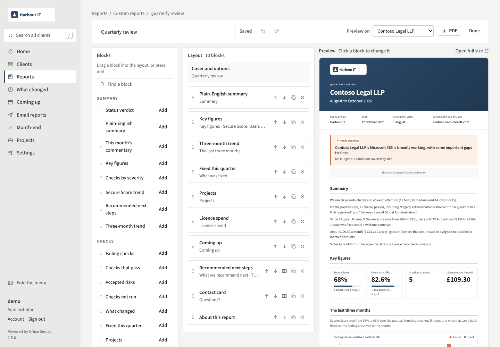

### SharePoint storage: why it's full and what to clean up

When a client's SharePoint fills up, the storage report shows how full it is (its quota worked out from
its licences) and when it will be full at the current rate, where the space goes (current files, older versions,
recycle bins, Preservation Hold libraries), every site and library by size, and the largest folders and files,
files with the most version history, large files nobody has touched for two years and the biggest recycle bin
items, each with what to do about it. OneDrives that are nearly full get the same treatment.
See the full [example PDF](examples/sharepoint-storage.pdf) for a client at 88%.

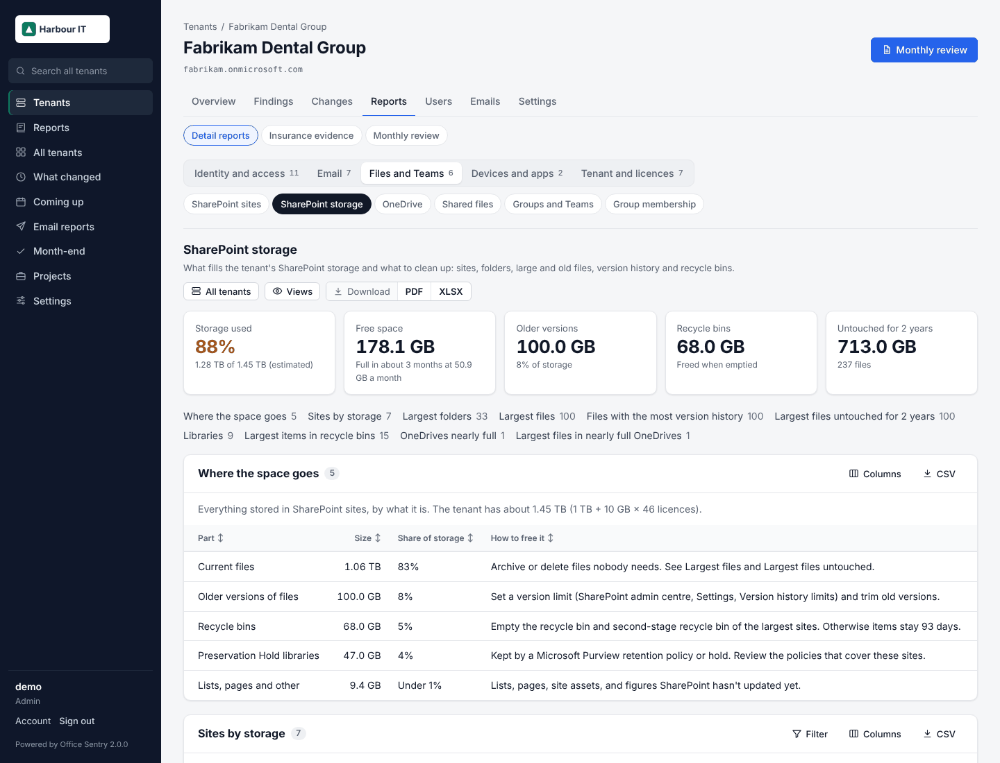

<table>
  <tr>
    <td width="60%">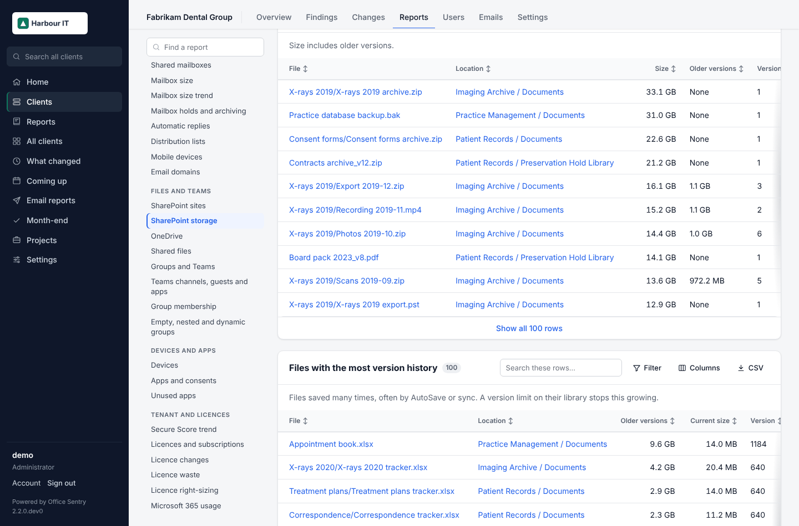</td>
    <td width="40%">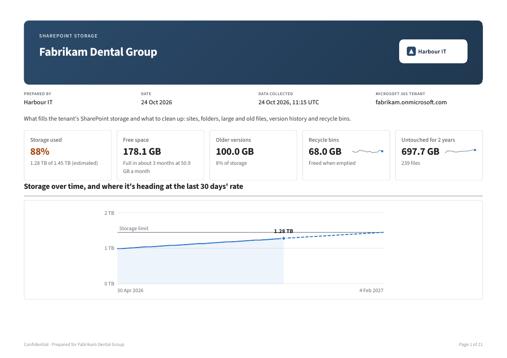</td>
  </tr>
  <tr>
    <td>The largest files, with their version history and who changed them last</td>
    <td>The same report as a PDF for the client (<a href="examples/sharepoint-storage.pdf">open it</a>)</td>
  </tr>
</table>

### Who can reach each site and team

**Site access** shows who owns, administers and can reach each SharePoint site: sites with no enabled owner or
only one, each site's owners, administrators, members and guests, what the default library grants and to whom,
every guest with the sites they can reach, and who administers many sites. **Site permissions** goes a level
deeper with SharePoint's own permissions: who is in each SharePoint group, the permission level each person and
group holds, the lists, libraries and subsites with permissions of their own, and any guest with full control.
**File and folder permissions** answers who can open what: every file and folder with permissions of its own, who
shared it and when, links past or near their expiry, and people outside who can edit. **Teams channels, guests and
apps** does the same for Teams: each team's private and shared channels with their members, the guests and people
from other organisations in them, the apps added to each team (custom uploads flagged) and teams nobody has used in
90 days.

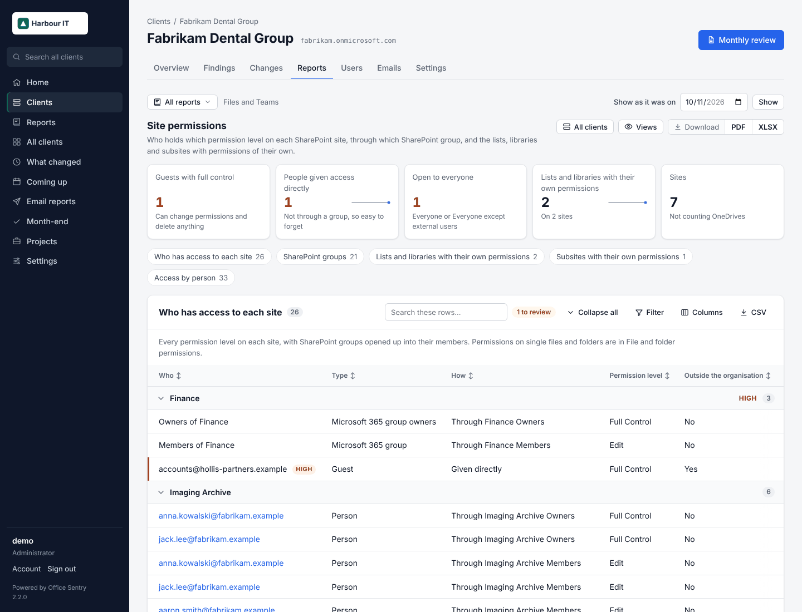

<table>
  <tr>
    <td width="50%">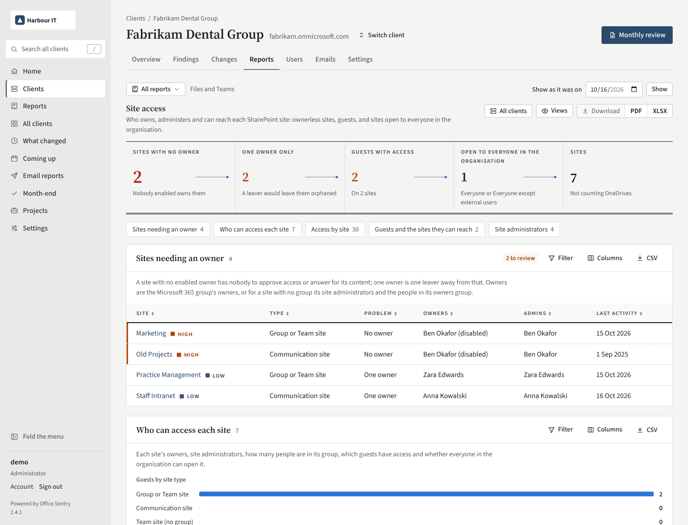</td>
    <td width="50%">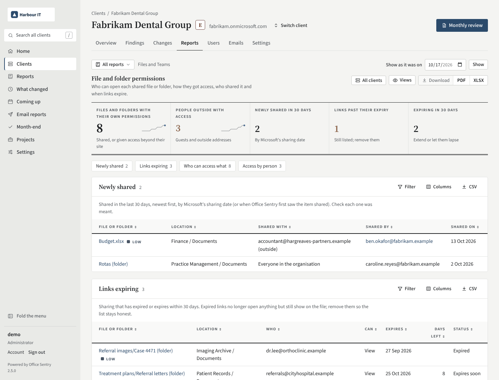</td>
  </tr>
  <tr>
    <td>Site access: sites with no owner or one, guests, and sites open to everyone</td>
    <td>File and folder permissions: what was newly shared, links expiring, and who can open each item</td>
  </tr>
</table>

### Who deleted, shared or opened what

The optional **audit log add-on** reads each approving client's Microsoft 365 audit log every night. **Files and
mailbox access** then shows who deleted, downloaded, moved or shared files, the anyone links made, mail read, sent
or deleted by an admin or a delegate, and inbox rules, forwarding and mailbox permissions set up, with what needs a
look first at the top. It keeps two years by default, where Microsoft's own search keeps 180 days, and never what's
in a file or an email. Every client, with the add-on or not, is also checked for an audit log that's switched off.
[Setting up the add-on](v2/docs/audit-log-addon.md)

<!-- since 2.6.0 -->
### Autodesk seats beside Microsoft 365 licences

For clients on Autodesk's Business Success Plan or Enterprise plan, **Autodesk licences** shows every Autodesk
subscription, who holds each seat and when they last used it, seats bought but not given to anyone, and seats still
held by people whose Microsoft 365 account is blocked or gone. Read-only, through Autodesk's own reporting API, with
each Autodesk team given to one client. [Setting up Autodesk](v2/docs/autodesk.md)
<!-- /since -->

### Detail reports you can filter, save and export

53 detail reports across identity, email, files and Teams, devices and licences. Every table can be filtered by its
values (or by age, for dates), sorted and have columns hidden; the view can be saved and reused on any client, and
the PDF, XLSX and CSV downloads contain exactly the rows shown. Every headline figure opens the rows behind it.
<!-- since 2.6.0 -->
Star the reports you use most and they list first on every client, and *Switch client* starts with the clients you
opened last.
<!-- /since -->

<table>
  <tr>
    <td width="50%">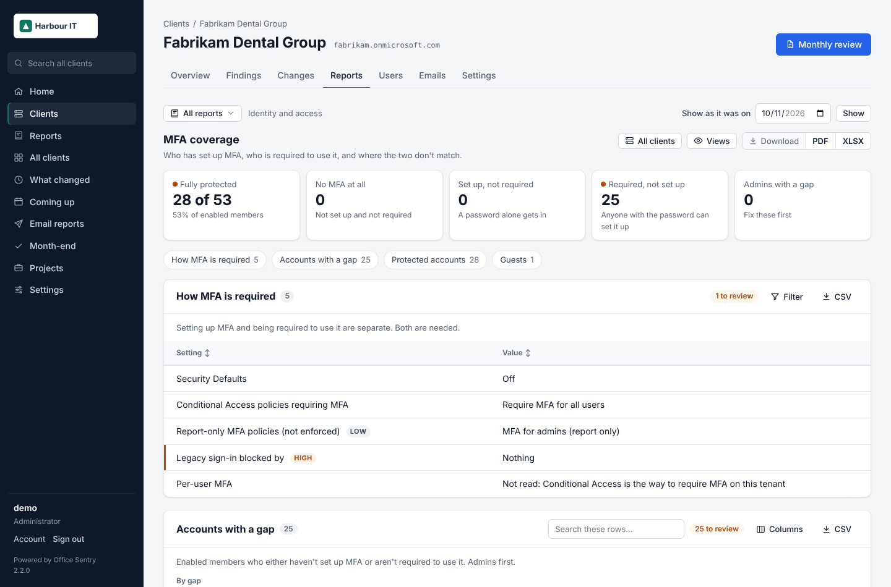<br>MFA coverage: who has set up MFA, who is required to, and where the two don't match</td>
    <td width="50%">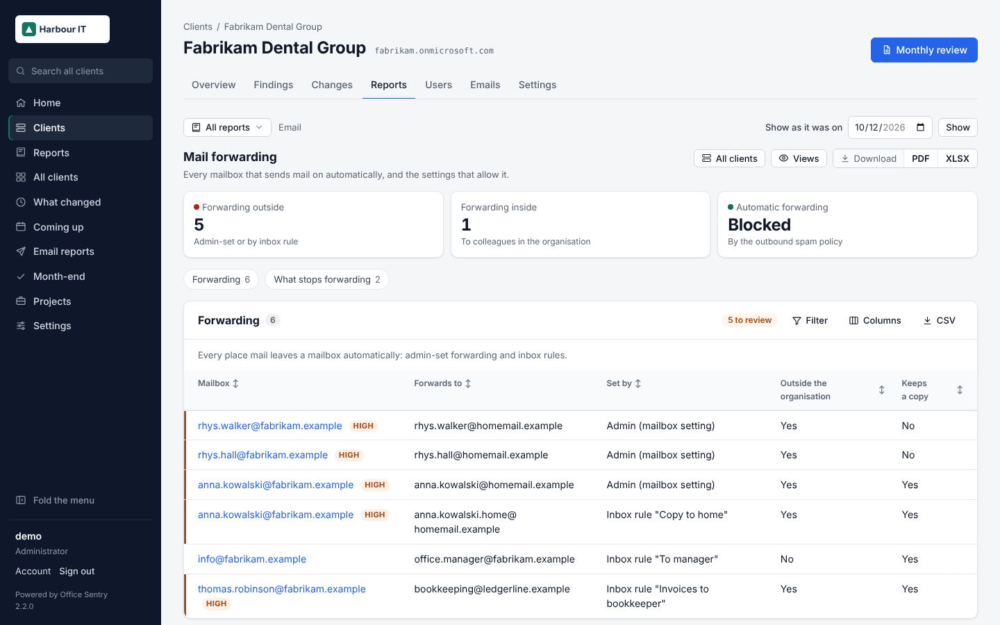<br>Mail forwarding: every forward outside, by admin setting or inbox rule</td>
  </tr>
  <tr>
    <td>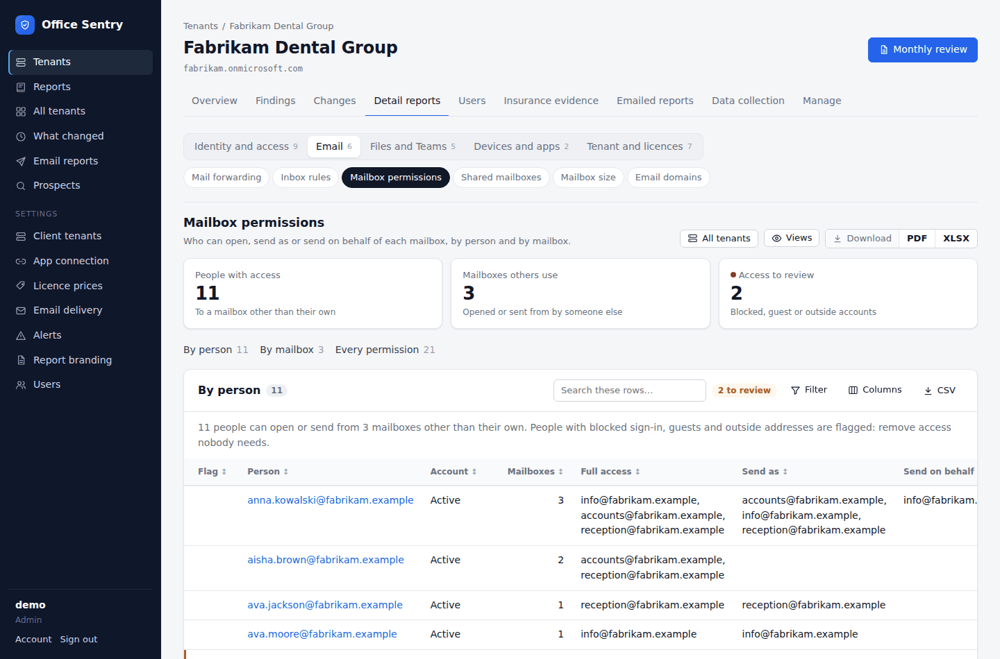<br>Mailbox permissions, with leavers and outside accounts flagged</td>
    <td>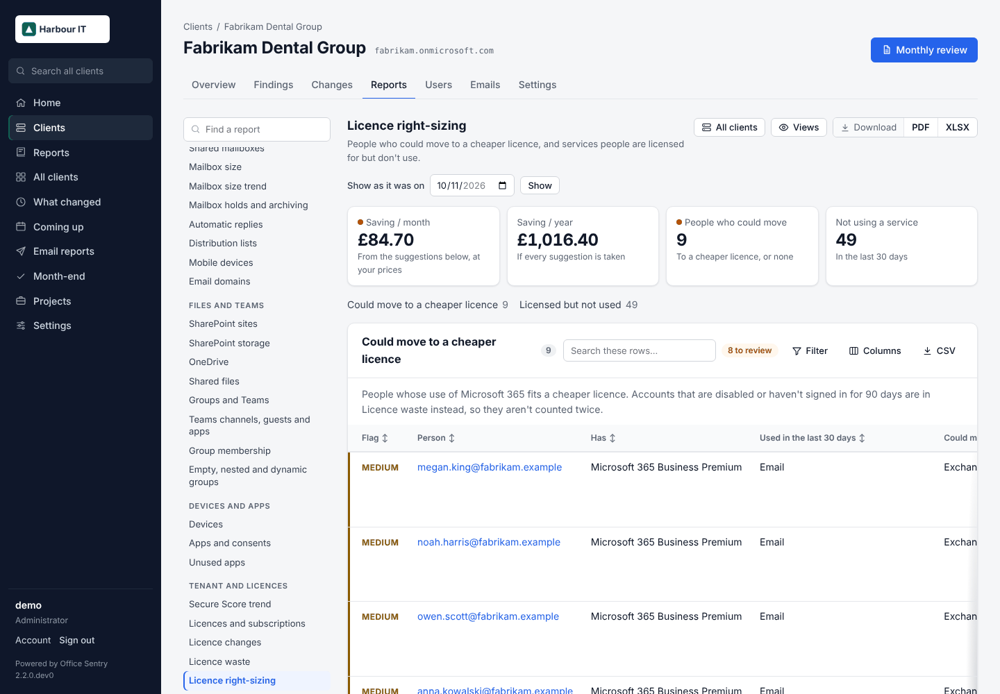<br>Licence right-sizing: who could move to a cheaper licence, and the saving</td>
  </tr>
  <tr>
    <td>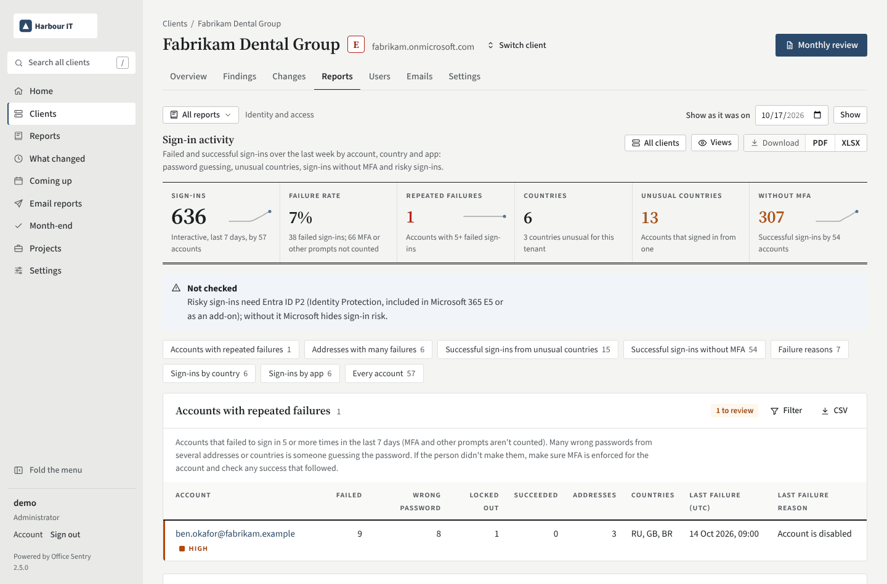<br>Sign-in activity: password guessing, unusual countries, sign-ins without MFA</td>
    <td>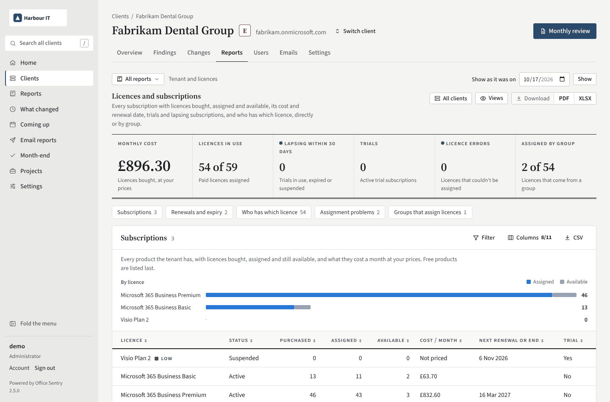<br>Licences and subscriptions: cost, renewals, trials and assignment errors</td>
  </tr>
  <tr>
    <td>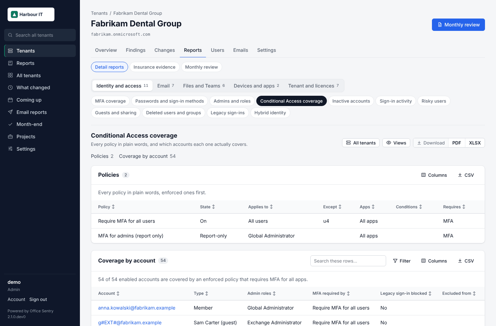<br>Conditional Access in plain words, and who each policy really covers</td>
    <td>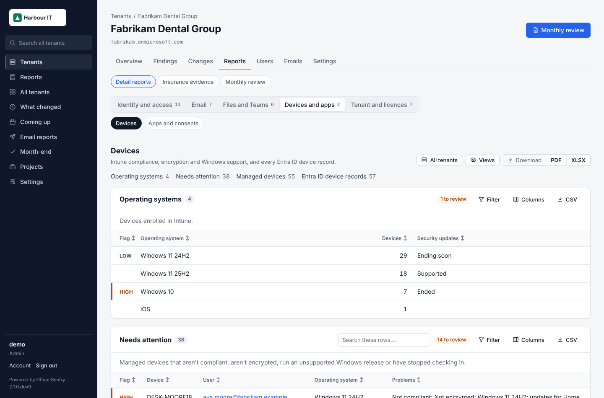<br>Devices: Windows support dates, compliance, encryption, check-ins</td>
  </tr>
  <tr>
    <td>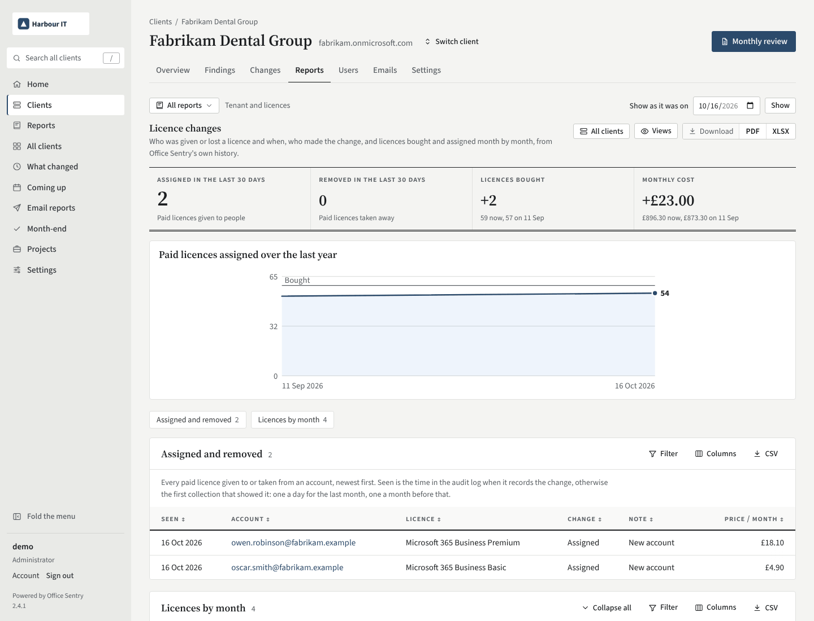<br>Licence changes: who was given or lost a licence, and licences bought and assigned month by month</td>
    <td>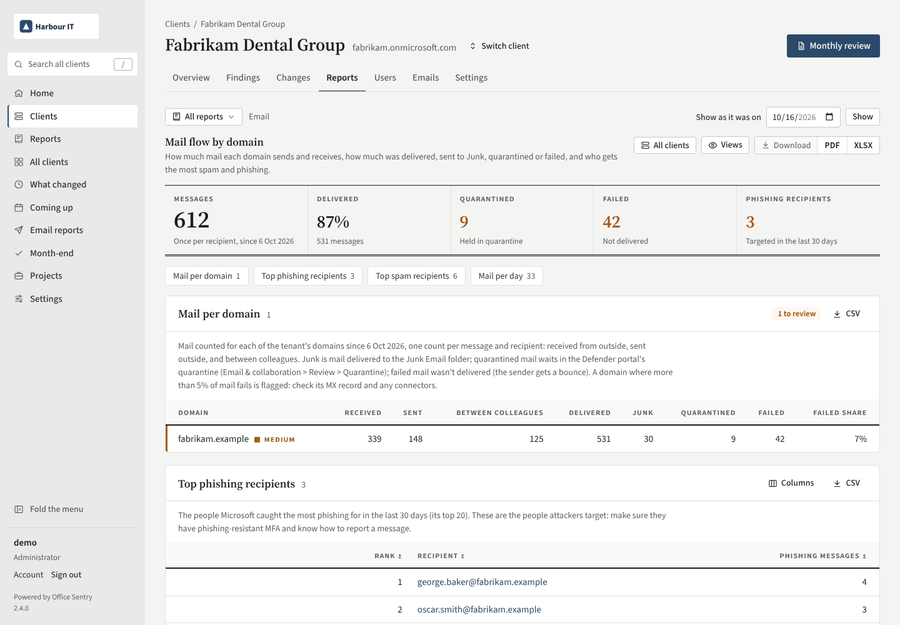<br>Mail flow by domain: mail received and sent, quarantined and failed mail, top spam and phishing recipients</td>
  </tr>
  <tr>
    <td>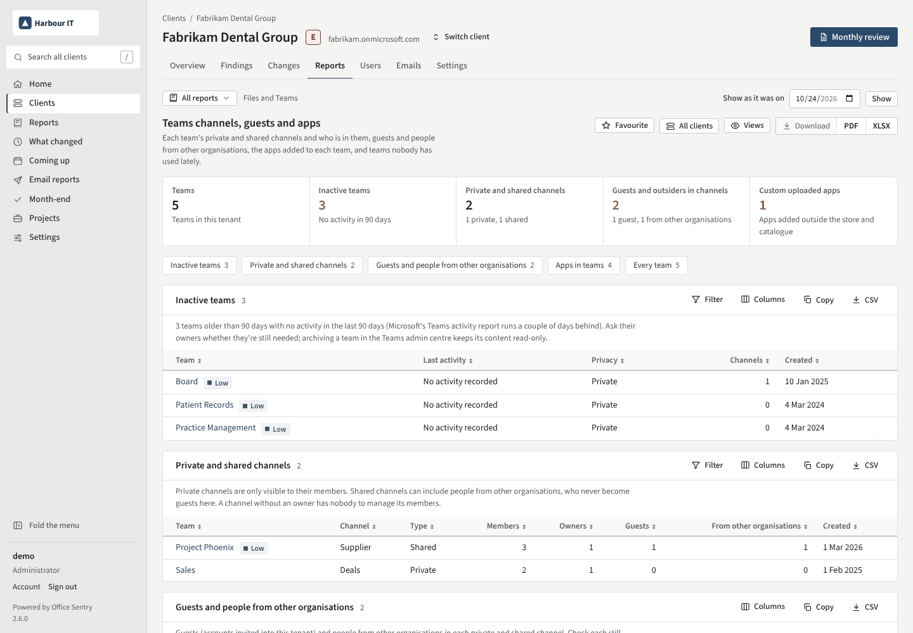<br>Teams: private and shared channels, the guests in them and the apps added</td>
    <td>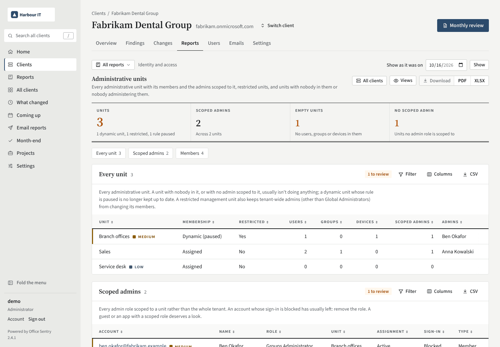<br>Administrative units: membership and who administers each unit</td>
  </tr>
</table>

There are 53 in all: mailboxes, inbox rules, shared mailboxes, mailbox size and its trend, automatic replies, mobile
devices, distribution lists, mail flow per domain, legacy sign-ins, passwords and sign-in methods, admins and roles,
administrative units, apps and consents, guests and sharing, groups and Teams, Teams channels with their guests and
apps, empty, nested and expiring groups, who can reach each SharePoint site and its permission levels, who can open
each shared file and folder, email domains with SPF, DKIM, DMARC and MTA-STS, hybrid identity, admin activity,
licence changes month by month, tenant settings, Microsoft 365 usage, Secure Score and more. The
[technical reference](v2/README.md#reports) describes them by area, and the
[catalogue](v2/docs/checks.md#detail-reports) lists every one with the data it reads. The **Reports** page finds any
of them by name or by the job you're doing ("Offboarding check", "Insurance renewal", "Storage cleanup").

<!-- since 2.6.0 -->
New in 2.6: **Microsoft 365 Copilot** shows who uses the Copilot licences you pay for and in which apps, the unused
ones and what they cost a month, and the busiest people without Copilot to give one to. **AI agents** lists the
agents with their own identity in Entra ID, which app made each and what it can reach on its own, flagging those that
can read mail or files or hold an admin role. It needs one new read-only permission, `AgentIdentity.Read.All`.
<!-- /since -->

New in 2.4: **Security alerts**, Microsoft Defender's open incidents and alerts with who is dealing with each, and **Service health**, Microsoft's outages and the message centre's changes with a date to act by. The Devices report adds which computers back up their local admin password with Windows LAPS. **Installed apps** lists every app Intune has found on managed devices, remote access tools first, and **Trusted organisations and locations** shows whose MFA the tenant accepts and the named locations Conditional Access trusts.

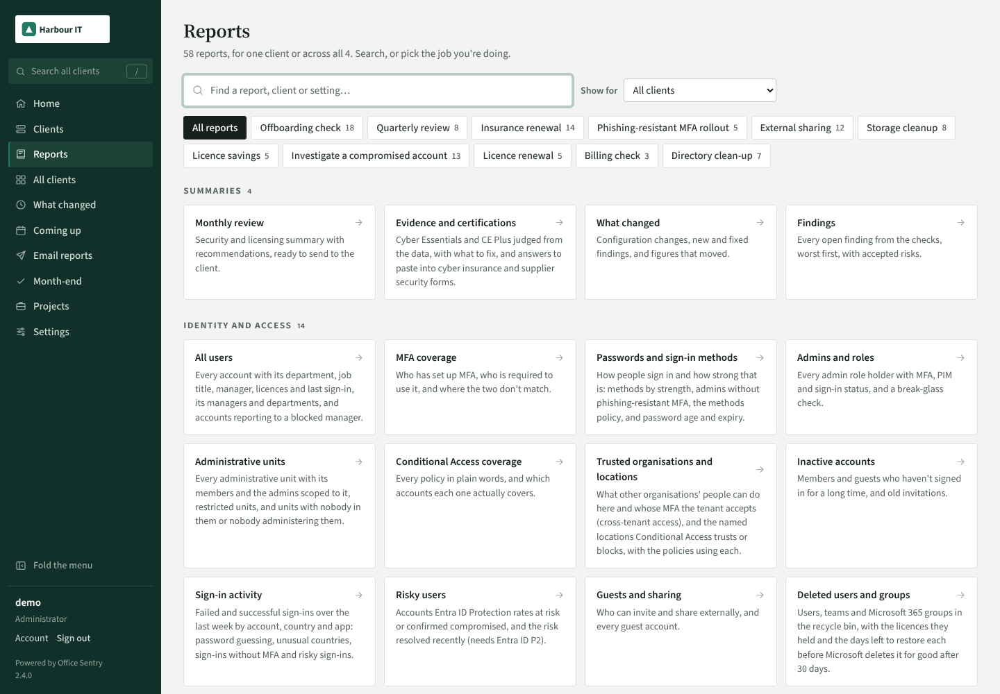

### A page for every person, mailbox, group and site

Everything about one account on one page: sign-in, MFA and methods, admin roles, licences and what they're used for,
mailbox forwarding and delegates, devices, sharing, the administrative units it's in, and a "Needs attention" list,
with how the account has changed over time. Useful for offboarding checks and "was this account compromised?"
questions.

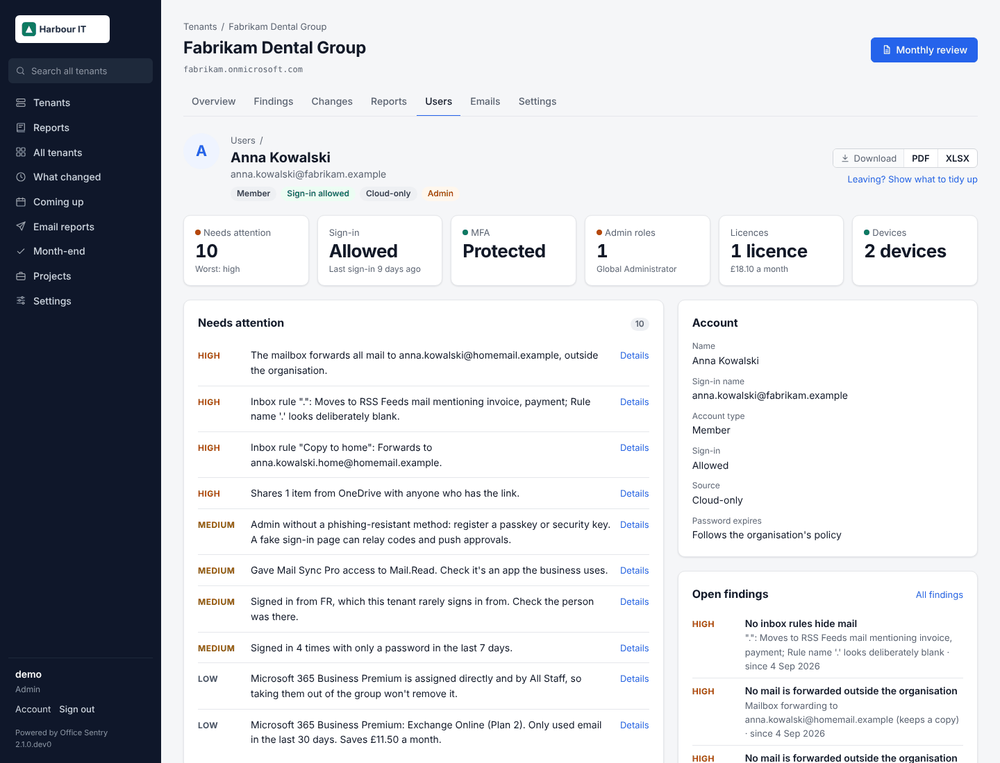

Mailboxes get the same treatment: **Users → Mailboxes** lists every mailbox with its size, forwarding and who
else can open it, and each has a page with its size and growth over time, inbox rules, access, protocols, automatic
reply, the phones syncing it and what changed. Mailbox addresses in reports and search results open it.
So do groups: **Users → Groups and teams** lists every team, Microsoft 365 group, security group and distribution
list, and each has a page with its owners and members, what membership gives (Conditional Access, admin roles,
licences), its mail and team site, how it's set up and what changed.
And SharePoint sites: **Users → Sites** lists every site with its storage, sharing links and last activity, and
each has a page with its storage and what fills it, how it's shared, the team behind it, its activity and what
changed. Site addresses in reports and on group pages open it.

<table>
  <tr>
    <td width="33%">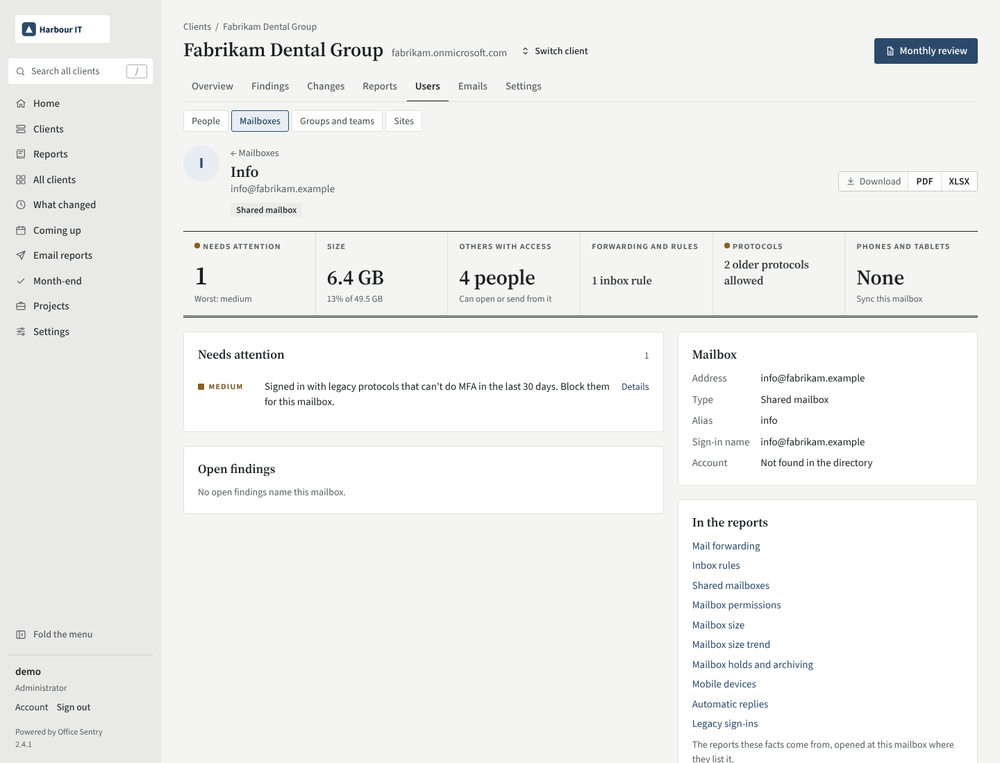</td>
    <td width="33%">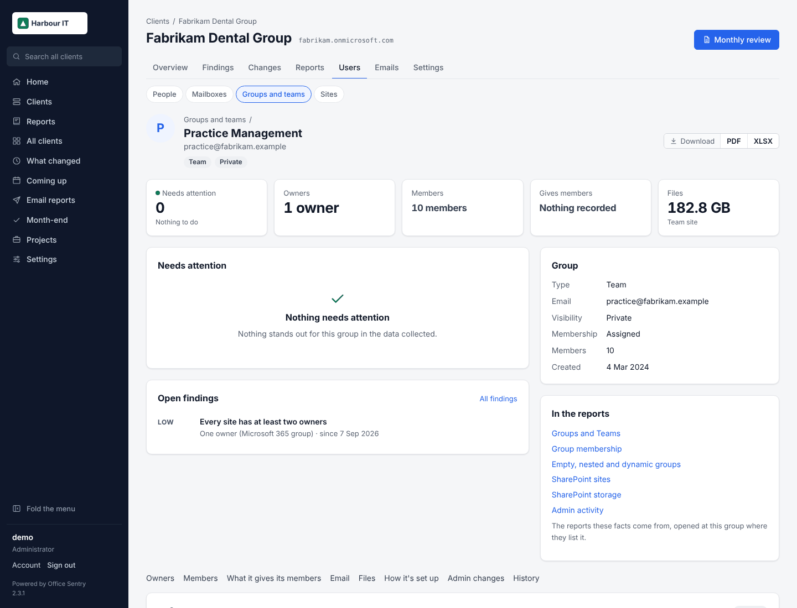</td>
    <td width="33%">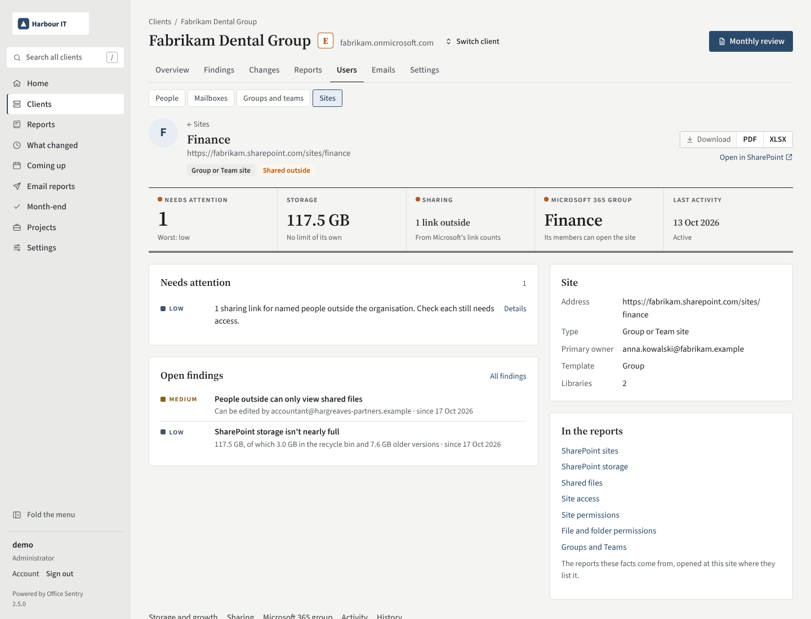</td>
  </tr>
  <tr>
    <td>A shared mailbox: size, rules, who can open it</td>
    <td>A team: owners, members and what membership gives</td>
    <td>A site: storage, sharing, the team behind it and its findings</td>
  </tr>
</table>

### Acting on a finding

Open any row of a client's Findings tab and the finding's sheet opens beside the table: the evidence behind it
(for an account, the facts from its page), its history (first seen, came back, accepted and by whom), where else
the same check fails across your clients, the fix as numbered steps, and the text to act on it. **Copy for a
ticket** puts a ready-made ticket on the clipboard, **Email the contact** opens a prefilled email to the client's
contact in your own mail app (Office Sentry sends nothing itself), and **Accept risk** is there too. The team can
keep a note on a finding and hand it to a colleague who sees that client; notes and hand-offs stay inside the
team and never reach a client's reports or emails. Nothing is ever written to the client's tenant.

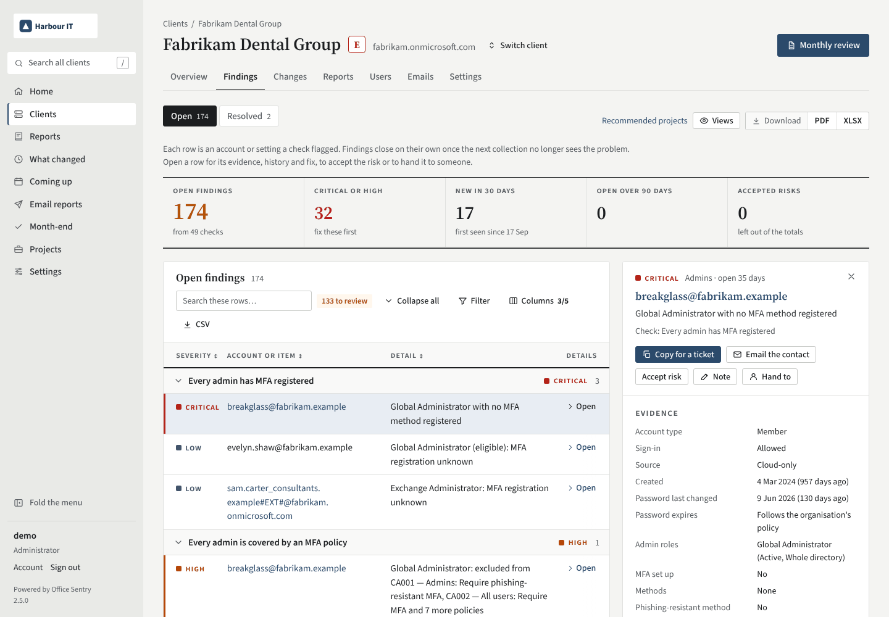

### Across all clients, and what changed

The **Clients** page puts every client side by side, worst first, with the monthly review's figures; pick any
report from its menu to compare it across every client (one row each, every figure clickable). **What changed**
lists month-over-month changes: new and fixed findings, admin, account, Conditional Access, forwarding, app, device
and group changes, and a row-by-row comparison of every detail report.

<table>
  <tr>
    <td width="50%">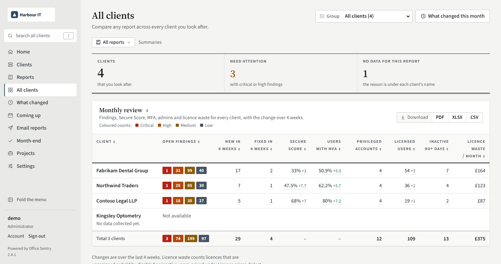</td>
    <td width="50%">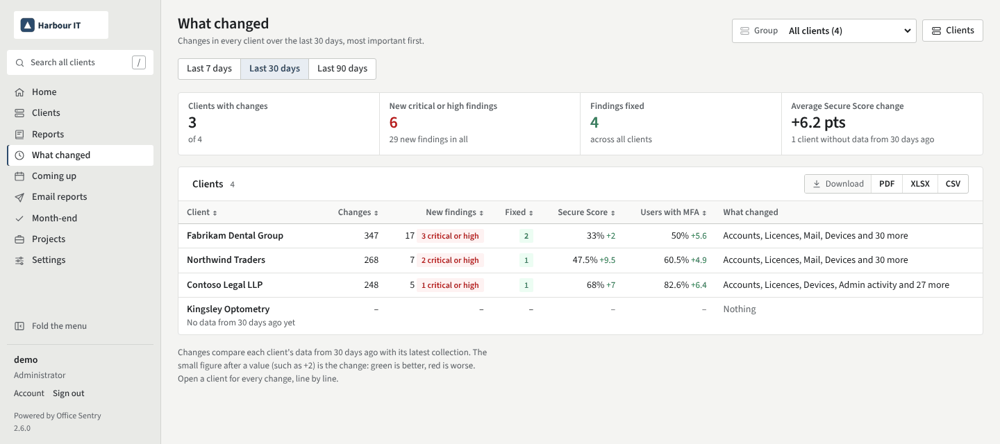</td>
  </tr>
  <tr>
    <td>Clients, with MFA coverage picked: one report for every client (the monthly review's figures as a <a href="examples/all-clients-monthly-review.pdf">PDF</a>)</td>
    <td>What changed in the last 30 days, most important first (<a href="examples/what-changed-all-clients.pdf">PDF</a>)</td>
  </tr>
</table>

### Emailed reports and alerts

Send any mix of reports weekly, monthly or quarterly at a time in the client's timezone: the client's people get
the email, your team a hidden copy. Saved views go too, with your filters, columns and sort, for one client or
across every client. Stale data is collected again first. There's a cross-client digest for your team, alert
emails when a scan finds something new and critical, and Teams, Slack or webhook alerts, including "the October
report for Contoso is ready" with a link into the portal. Every send is
logged, failures retry automatically, and you can preview at desktop and phone width.

<!-- since 2.6.0 -->
The same webhook can tell you when someone makes a risky change in a client's tenant, read from its directory audit
log at each collection: "Contoso: bob@contoso.com made Global Administrator", a Conditional Access policy deleted or
turned off, security defaults turned off, or a sign-in method removed from an admin. Each change is posted once,
with who made it and when.
<!-- /since -->

<table>
  <tr>
    <td width="50%">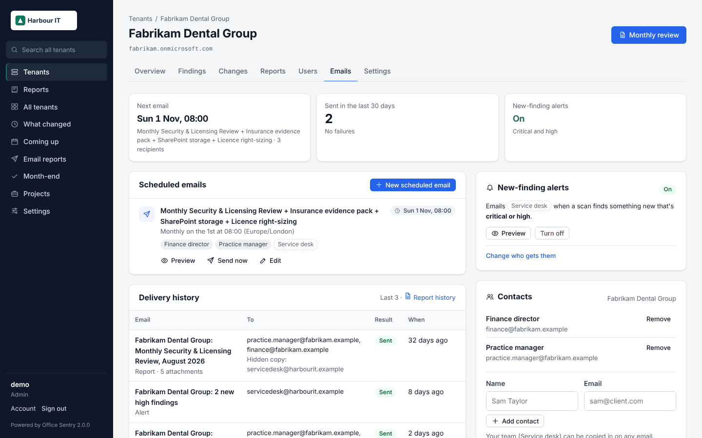</td>
    <td width="50%">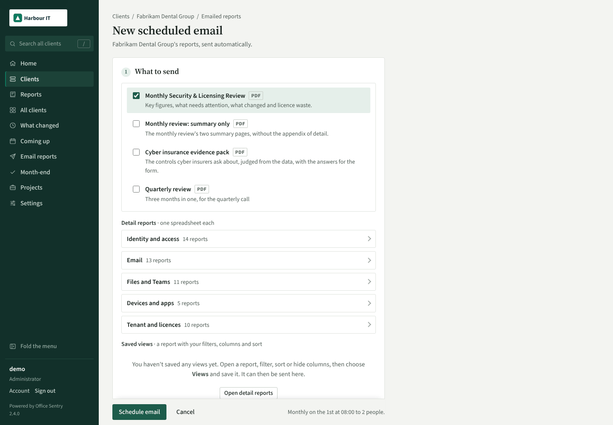</td>
  </tr>
  <tr>
    <td>Schedules, alerts, contacts and the delivery history</td>
    <td>Choosing what to send and when</td>
  </tr>
</table>

### Evidence and certifications

The **Evidence page** starts with the scheme the client is going for. **Cyber Essentials** and **Cyber
Essentials Plus** are judged from the data as an assessor would, control by control: *Pass*, *Fail* (any gap
fails; the auto-fail questions are marked), *Partly*, or *Your evidence* where Microsoft 365 can't show it
(firewalls, patching, anti-malware), with the figures, the fix and a text to paste. The page leads with what to
fix before applying, compares with last month or last year, says what the CE Plus assessor will test, and
carries the answers for the IASME portal with one-tap copy; downloads come as PDF, Word, text, XLSX and CSV.
**IASME Cyber Assurance**, **ISO/IEC 27001 Annex A** and **UK GDPR** (the ICO's security outcomes and the
accountability records) are judged the same way, and so are the **CIS Microsoft 365 benchmark**, **NIST CSF
2.0**, **SOC 2** and Australia's **Essential Eight** for clients asked to map to them. The **cyber insurance proposal** and **supplier security
questionnaire** packs turn the same data into answers in each form's wording, with a text to complete where
Microsoft 365 can't answer; one written answer fills every pack.

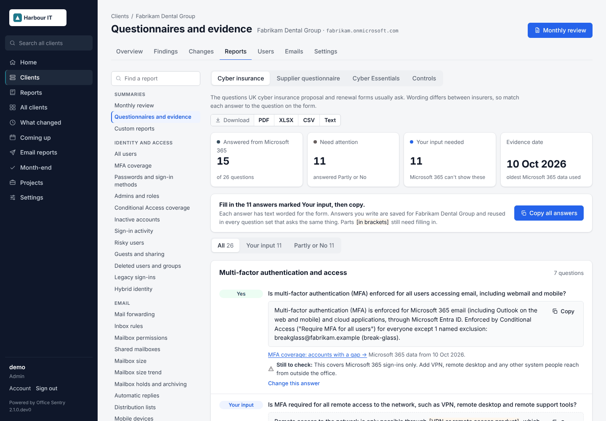

<table>
  <tr>
    <td width="60%">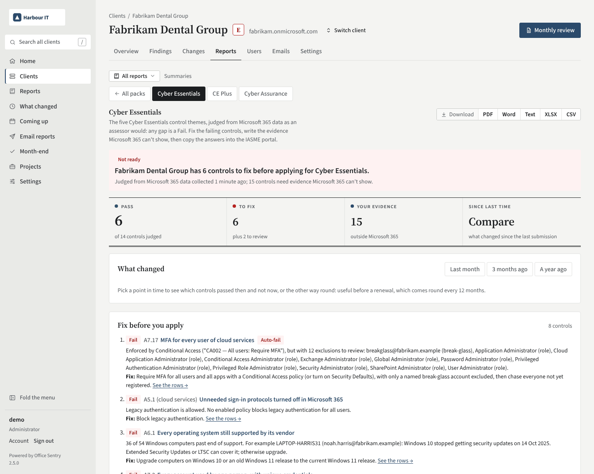</td>
    <td width="40%">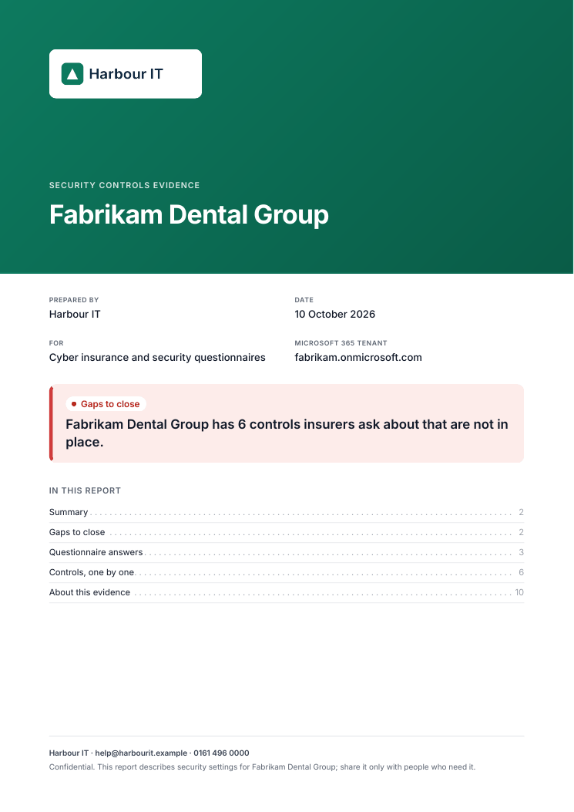</td>
  </tr>
  <tr>
    <td>Cyber Essentials: what to fix, each control's verdict and the text to paste</td>
    <td>The pack as a PDF (<a href="examples/cyber-essentials-evidence.pdf">open it</a>; the <a href="examples/insurance-evidence-pack.pdf">insurance pack</a>)</td>
  </tr>
</table>

### Recommended projects

**Projects** turns each client's findings into the projects an account manager can sell: no Conditional Access
becomes an *Identity and Conditional Access* project, unencrypted laptops a *Device management* one, missing
Business Premium features a *Security licence upgrade*, a small business still syncing accounts from an office
server *Move to cloud-only accounts*, and so on. A project is half a day's work or more; anything smaller, like
registering MFA for one admin, and repairs, like directory sync that has stopped, are quick fixes the team just
does, listed on the client's page. Every client's recommendations sit in one list, worst first, with what was
found, how big the job is, a rough estimate and where it stands (suggested, proposed, agreed or declined, with a
note). Each client's page downloads a branded proposal PDF to send them, listing only the work their findings call
for. A project drops off by itself once its findings are fixed.

<table>
  <tr>
    <td width="50%">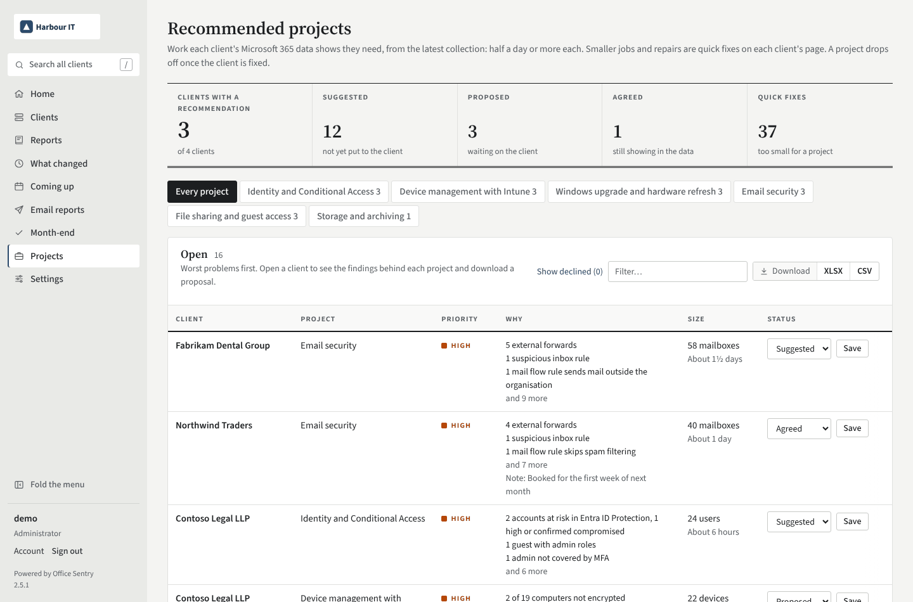</td>
    <td width="50%">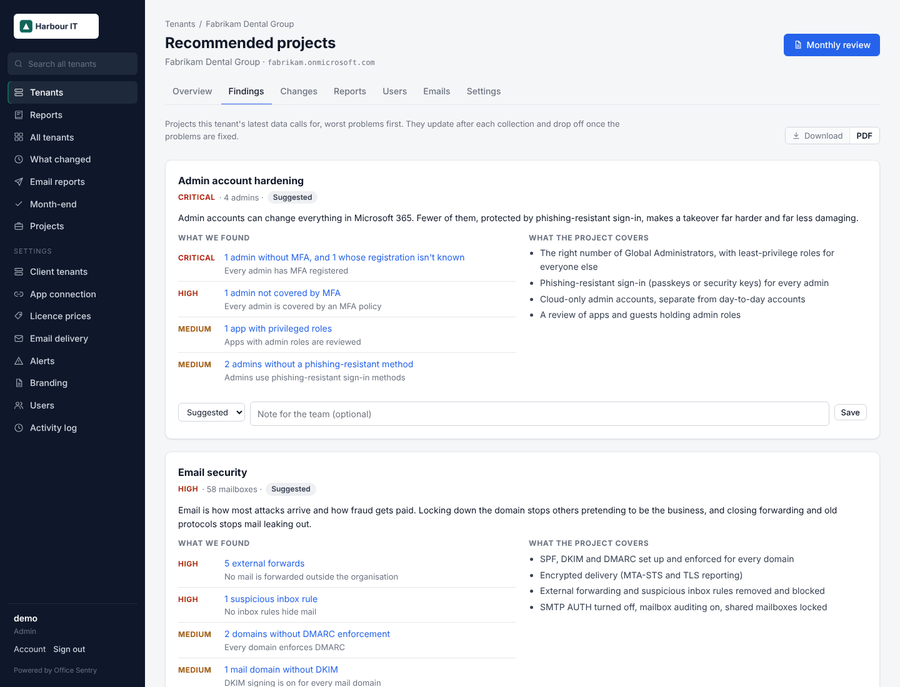</td>
  </tr>
  <tr>
    <td>Every client's recommended projects, worst first</td>
    <td>One client's projects with the findings behind them (<a href="examples/recommended-projects.pdf">proposal PDF</a>)</td>
  </tr>
</table>

### A grade for every client

Every client gets a **grade from A to E**: one letter to put in front of a client, worked out the same way for
everyone, with the rules published so you can say exactly why they are a C and what makes them a B. The checks are
grouped into five parts (admin accounts, sign-in and accounts, mail, devices, and sharing and apps); a part's grade
is its worst open finding after accepted risks are set aside, and the grade is the worst part, so one critical gap
keeps a client out of A and B whatever else is in good shape. The grade sits beside the client's name on every page
about them, shows on the Clients page and leads the figures on their Overview, and its own page shows what moves each part, the grade on each
of the last twelve month-ends, and how the client compares with the others you look after of about the same size
(the median grade, Secure Score, MFA coverage, open critical and high findings and licence waste per user), without
naming any of them. Nothing about a client leaves your install. The rules are in
[Client grades](v2/docs/client-grades.md).

### A view for clients

Client users can sign in too. They see only their own organisation's reports, key numbers and downloads, never
collection internals, run logs or other clients. They can sign in with their own work Microsoft account, under
their organisation's own MFA, from their own tenant only: no guest accounts in yours and no passwords to hand
out ([Client sign-in](v2/docs/client-sign-in.md)).

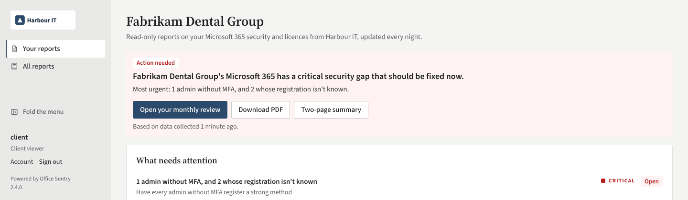

### Your team, each with the access they need

Everyone at your MSP has a role made of capabilities, and sees only the clients they're given. Seven roles are built
in: Administrator, Team leader, Second line, First line (looks things up, changes nothing), Account manager
(licences, renewals, month-end reports and projects), Auditor (every report, read-only) and Client viewer. **Settings
→ Users → Roles** changes what a built-in role holds or adds your own, and **Customise** on a person's page gives or
takes away single capabilities, everywhere or on one client. Staff can sign in with their Microsoft work account,
under your own Conditional Access and MFA, with their role assigned in Entra ([Staff
sign-in](v2/docs/staff-sign-in.md)).

<table>
  <tr>
    <td width="50%">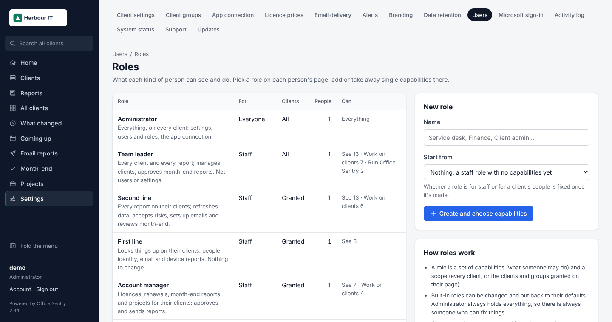</td>
    <td width="50%">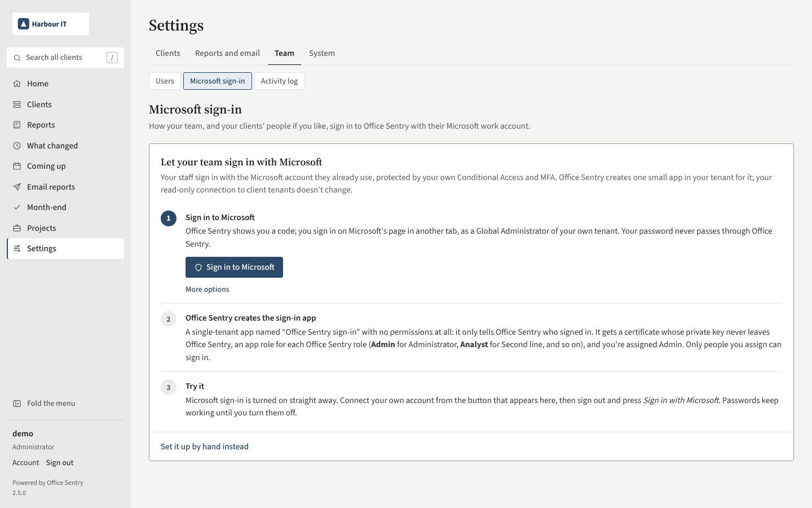</td>
  </tr>
  <tr>
    <td>Roles: what each kind of person can see and do</td>
    <td>Staff sign-in: one button sets up sign-in with Microsoft</td>
  </tr>
</table>

### Managing clients

Adding a client shows a setup checklist that ticks itself off: admin consent, Global Reader, the first collection
and every permission granted. **Client settings** lists every client's connection health, worst first, and each
client's **Manage** tab says in plain words what's wrong and where to click to fix it. When a release asks for new
permissions, **Update the app** adds them to your app registration with one sign-in, and the Onboarding tracker
lists the clients still to approve them, each with a **What's new** page: the email to send, the approval link and a
PDF saying what each permission reads. Clients can be paused or archived, and **Offboard** walks through a final
export and the client's side, then deletes the client and everything stored for it, with no SQL.

<table>
  <tr>
    <td width="50%">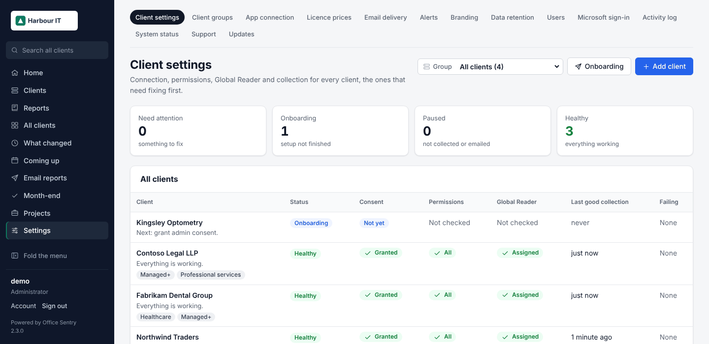</td>
    <td width="50%">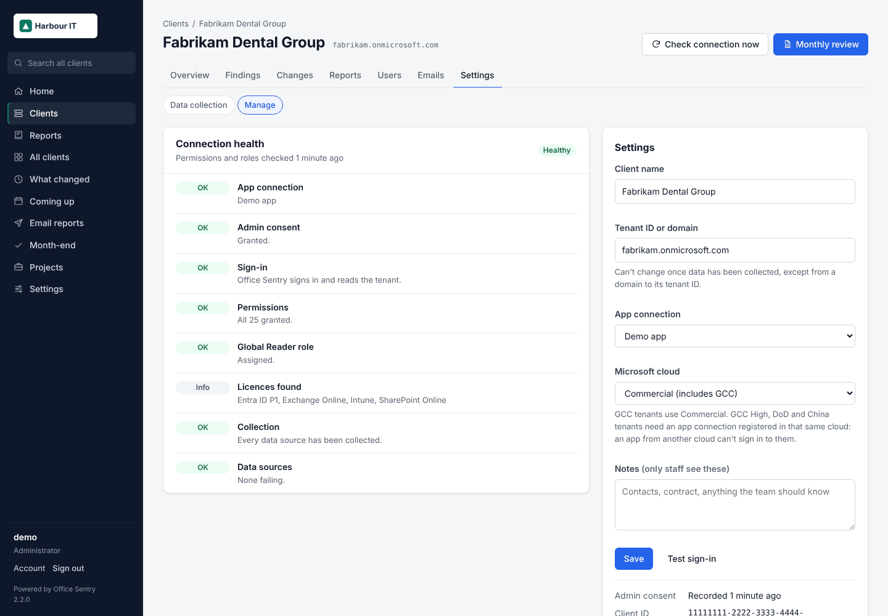</td>
  </tr>
  <tr>
    <td>Connection health for every client</td>
    <td>One client's connection, permissions and settings</td>
  </tr>
  <tr>
    <td>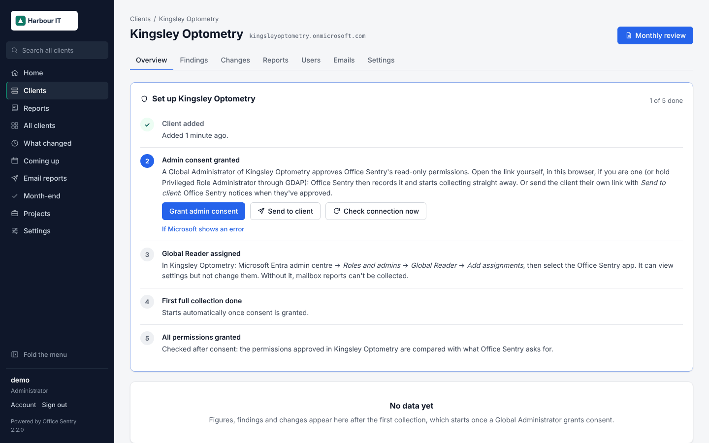</td>
    <td>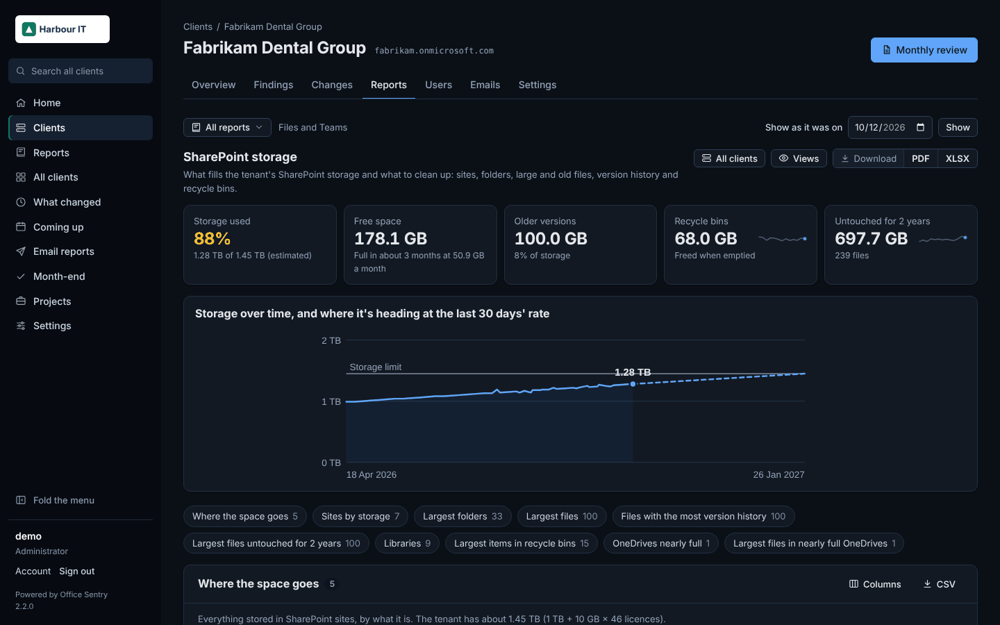</td>
  </tr>
  <tr>
    <td>The checklist for a client being added</td>
    <td>Dark mode follows your system setting
    unless you choose Light or Dark on your Account page, where staff also pick a colour
    </td>
  </tr>
</table>

## Example reports

[`examples/`](examples/) has real exports from the demo data: the monthly review (PDF and XLSX) and its summary PDF,
a quarterly review, Cyber Essentials evidence, the insurance evidence pack, SharePoint storage, MFA coverage, mailbox
permissions, mail forwarding, licence right-sizing, sign-in activity, sign-in methods, subscriptions, Conditional
Access, an account page, What changed, the Clients page and a recommended projects proposal. All of it is fictional.

## Security model

Office Sentry holds read access to many clients, so it is built to do as little as possible with it.

- **Read-only by construction.** One multi-tenant Entra app asks only for read permissions (`*.Read*`, plus
  `Exchange.ManageAsApp`). The Graph client has no write methods, and the Exchange client refuses any cmdlet that
  isn't on a fixed allow-list of `Get-` cmdlets. It never creates or changes anything in a client's tenant.
- **The audit log add-on is a second app with one permission** (`ActivityFeed.Read`), off until you turn it on and approved by each client you ask. It keeps file, sharing and mailbox events, never what's in a file or an email.
- **Certificate sign-in, no credential files.** The app signs in with a certificate whose private key is encrypted
  in the database. Secrets and private keys are never downloadable; only the public `.cer` is, by admins.
- **Tenant isolation and roles.** Deny by default: people see only the clients they're granted, every client
  page goes through one access check, and anything else returns 404. What they may do there is a role made of
  capabilities ([Your team](#your-team-each-with-the-access-they-need)), narrowed or widened per person and per
  client by an admin. Clients see only their own reports.
- **The one thing it sends is your own email:** reports and alerts, through your mail server or a separate app in
  your own tenant that can only send mail (`Mail.Send`).
- **The portal itself:** staff can sign in with their own Microsoft account (Entra ID, under your Conditional
  Access and MFA; roles assigned in Entra), or with two-step sign-in, which is required for everyone on new
  installs, client accounts included; wrong passwords
  slow down the address they come from rather than locking the account, so nobody can lock a colleague out;
  server-side sessions, CSRF protection, a strict Content Security Policy with no external assets, and encrypted
  secrets with key rotation.

Details are in [SECURITY.md](SECURITY.md) and [Securing the portal](v2/docs/securing-the-portal.md).

## What it reads

[What Office Sentry reads](v2/docs/what-office-sentry-reads.md) is written for a client's owner or IT contact who
has been asked to approve access: every permission, what is and isn't read (no email contents), where the data is
kept and how to remove access. Send it with the consent link.

## Quick start

Office Sentry runs as two containers (the portal and a worker) from one image, with everything stored in one
Docker volume.

Download `docker-compose.yml`, `Caddyfile` and `env.example` from the newest
[release](https://github.com/JackD99/OfficeSentry/releases) into a folder on a Linux server with Docker, then:

```bash
cp env.example .env           # set OFFICESENTRY_BASE_URL, OFFICESENTRY_DOMAIN and OFFICESENTRY_TIMEZONE
echo COMPOSE_PROFILES=https >> .env    # Caddy, for HTTPS with a certificate from Let's Encrypt
docker compose up -d
```

The image is [`ghcr.io/jackd99/officesentry`](https://github.com/JackD99/OfficeSentry/pkgs/container/officesentry),
public, for amd64 (Intel and AMD) and arm64 servers. It is built and
scanned by GitHub Actions from a tagged release, with a signed build provenance you can check
([SECURITY.md, "Checking a release"](SECURITY.md#checking-a-release)). Each release lists what changed,
and anything to do before updating, in [CHANGELOG.md](CHANGELOG.md). **Settings → Updates** shows those notes for
every newer release, and an optional **Update** button installs one: it checks the release's signature, restarts
Office Sentry on it and goes back by itself if it doesn't start ([The Update button](v2/DEPLOY.md#the-update-button)).

Leave out the `COMPOSE_PROFILES` line if you already have a reverse proxy, and point it at
`http://127.0.0.1:8000`. Then:

1. Run `docker compose logs web` and open the link on the line starting **No admin account yet** to create the
   first admin (with two-step sign-in). Your home page then shows a **Get started** checklist (the app connection,
   your first client, its consent and its first collection), which ticks itself off as you go.
2. Open **Settings → App connection** and press **Sign in to Microsoft**. The page shows a code and Microsoft's
   link: enter the code there and sign in as an admin of **your own** (MSP) tenant who can create app
   registrations. Office Sentry then creates its multi-tenant, read-only app with a certificate and saves it, with
   nothing to type on the server. (`docker compose run --rm worker python -m officesentry create-app` does the
   same from the command line.)
3. Add your first client on the same page and follow its checklist: a Global Administrator of the client's
   tenant grants consent, you assign Global Reader, and the first collection runs.

Stuck? [Troubleshooting](v2/docs/troubleshooting.md) covers the common errors, such as `AADSTS50011` on the
consent page, mailboxes failing without Global Reader and the worker not running. For anything else,
**Settings → Support** makes a support package to attach to a bug report, with secrets and client names taken
out ([Getting help](v2/docs/getting-help.md)).

[v2/DEPLOY.md](v2/DEPLOY.md) covers HTTPS, the collection schedule, retention, backups and updating. Running
Portainer, a NAS, Kubernetes, Azure, AWS or another cloud? The [deploy guides](v2/docs/deploy/README.md) start
from there.

## Documentation

- [Technical reference](v2/README.md): every report and check by area, Exchange data, sign-in security and settings
- [Running it on your own server](v2/DEPLOY.md)
- [Deploy guides](v2/docs/deploy/README.md): Portainer and other container managers, Unraid, Synology and
  TrueNAS, Kubernetes, Azure, AWS, other clouds and Cloudflare
- [Staff sign-in with Microsoft](v2/docs/staff-sign-in.md): let your team sign in with their Entra ID account
- [Client sign-in with Microsoft](v2/docs/client-sign-in.md): let your clients' people sign in with their own
  work account
- [Onboarding a client](v2/docs/onboarding-a-client.md): consent, Global Reader, the first collection, connection
  health and offboarding
- [Client grades](v2/docs/client-grades.md): how a client's A to E grade is worked out, its history and comparison
- [What Office Sentry reads](v2/docs/what-office-sentry-reads.md): for clients approving access
- [Check catalogue](v2/docs/checks.md): every check, data source, detail report and permission
- [Troubleshooting](v2/docs/troubleshooting.md): the common setup and collection errors and their fixes
- [Getting help](v2/docs/getting-help.md): where to look first, the support package and what it leaves out
- [Securing the portal](v2/docs/securing-the-portal.md): hardening defaults, what you have to do, reverse proxies
- [How it compares](website/pages/compare/reporting-tools.md): Office Sentry next to Microsoft's admin centres,
  PowerShell, CIPP and AdminDroid
- [Example reports](examples/)
- [Roadmap](ROADMAP.md): what's planned next, and what never will be
- [Changelog](CHANGELOG.md): what changed in each release

## Development

All code is in [`v2/`](v2/): Flask, SQLite and WeasyPrint, with one background worker and no Redis or Celery.

```bash
cd v2
python -m venv .venv && . .venv/bin/activate
pip install -e '.[dev]'
ruff format . && ruff check . && pytest
OFFICESENTRY_INSECURE_COOKIES=1 python -m officesentry web   # http://127.0.0.1:8000
```

`python scripts/demo_data.py --data-dir /tmp/officesentry-demo` builds demo clients to click around in.
The screenshots and example reports here are made by `python scripts/screenshots.py` from the same demo data;
re-run it when the UI or reports change. [DEVELOPING.md](DEVELOPING.md) is a short tour of the code and tests, and
[CONTRIBUTING.md](CONTRIBUTING.md) has the conventions.

## Getting help and contributing

[SUPPORT.md](SUPPORT.md) says where to go for what: [Troubleshooting](v2/docs/troubleshooting.md) for setup
errors, [Discussions](https://github.com/JackD99/OfficeSentry/discussions) for questions, and the
[issue forms](https://github.com/JackD99/OfficeSentry/issues/new/choose) for bugs (attach the support package
from the portal's Settings) and for report, check and feature requests. Issues are public: never paste a
client's data.

Pull requests are welcome. [CONTRIBUTING.md](CONTRIBUTING.md) has the conventions and how every change is
checked, and [DEVELOPING.md](DEVELOPING.md) is the tour of the code. Everyone taking part agrees to the
[code of conduct](CODE_OF_CONDUCT.md).

## Security issues

Please report vulnerabilities privately, as described in [SECURITY.md](SECURITY.md). Don't open a public issue.

## Licence

Office Sentry is free software under the [GNU Affero General Public License v3.0](LICENSE) (AGPL-3.0-only).
You can use, change and share it; if you run a modified version for others over a network, you must offer them
its source code under the same licence.
