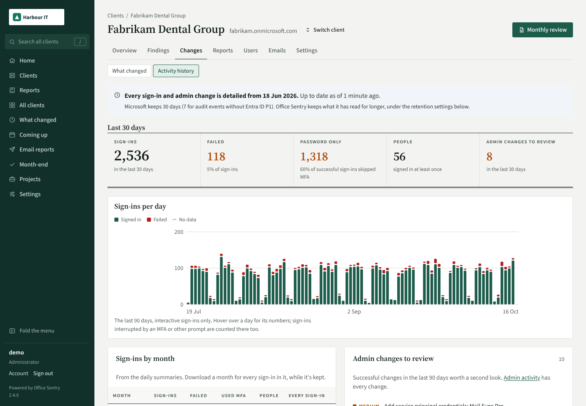

# Keep Microsoft 365 sign-in and audit logs past 30 days

"Was this account compromised in March?" and "who made her a Global Admin?" are questions that arrive months
later, and by then Microsoft has deleted the answer. Entra ID keeps sign-in logs and directory audit logs for
**30 days** with Entra ID P1 or P2, and **7 days** without. The unified audit log in Microsoft Purview (file,
sharing and mailbox activity) keeps 180 days on standard licences. To answer older questions, the logs have
to be copied somewhere before they go.

## Ways to keep them longer

### Download them

In the Entra admin centre, **Monitoring & health → Sign-in logs** (and **Audit logs**) has a **Download**
button. It's free and quick, but someone has to remember it every month for every client, and big downloads
are capped.

### PowerShell on a schedule

The Microsoft Graph module reads both logs (the tenant needs Entra ID P1). Run something like this daily and
keep the files somewhere safe:

```powershell
Connect-MgGraph -Scopes "AuditLog.Read.All"
$since = (Get-Date).ToUniversalTime().AddDays(-1).ToString("yyyy-MM-ddTHH:mm:ssZ")

Get-MgAuditLogSignIn -All -Filter "createdDateTime ge $since" |
    Select-Object CreatedDateTime, UserPrincipalName, AppDisplayName, IpAddress,
        @{ Name = "Country"; Expression = { $_.Location.CountryOrRegion } },
        @{ Name = "ErrorCode"; Expression = { $_.Status.ErrorCode } } |
    Export-Csv "signins-$(Get-Date -Format yyyy-MM-dd).csv" -NoTypeInformation

Get-MgAuditLogDirectoryAudit -All -Filter "activityDateTime ge $since" |
    Select-Object ActivityDateTime, ActivityDisplayName, Result,
        @{ Name = "By"; Expression = { $_.InitiatedBy.User.UserPrincipalName } } |
    Export-Csv "audit-$(Get-Date -Format yyyy-MM-dd).csv" -NoTypeInformation
```

It works, but a missed day is a gap you can't fill once Microsoft has deleted it, and a folder of CSV files
is hard to search when the question finally comes.

### Send them to Azure

**Monitoring & health → Diagnostic settings** in the Entra admin centre can stream `SignInLogs` and
`AuditLogs` to a Log Analytics workspace, a storage account or Microsoft Sentinel. It's the most complete
option and easy to query, but it needs an Azure subscription, Log Analytics charges by the gigabyte, and it's
set up separately in every client's tenant.

### Buy longer retention

Microsoft Purview Audit (Premium), part of E5 and some add-ons, keeps audit records for up to 10 years.

## Every client, kept by default

Office Sentry reads each client's sign-in and directory audit logs every night and keeps them, so the answer
is still there after Microsoft deletes its copy.



- By default it keeps sign-ins in full for 180 days, a daily summary per person for 25 months, and admin
  changes for 7 years. The periods are settings.
- Each run carries on from where the last one stopped, so a night the server was off loses nothing, as long
  as Microsoft still has the data.
- Each client's **Activity history** shows sign-ins per day and each month with a CSV of every sign-in; each
  person's page shows their own sign-ins by month.
- **Admin activity** lists 12 months of admin changes, riskiest first: roles granted, Conditional Access
  changed or switched off, app credentials added, federation changes.
- **Sign-in activity** summarises the last week: password guessing, sign-ins from unusual countries, and
  sign-ins that needed only a password.

The history starts on the day Office Sentry first reads a tenant, so it's worth adding clients early. Reading
the sign-in log needs Entra ID P1 in the tenant. File, sharing and mailbox activity from the unified audit
log needs the optional audit log add-on: see
[Find who deleted or shared a file, or opened someone's mailbox](audit-log.md).

[Open the activity history in the demo](https://demo.officesentry.co.uk/tenants/1/activity) ·
[Example PDF](../../../examples/sign-in-activity.pdf) ·
[Install Office Sentry](../../../README.md#quick-start)
